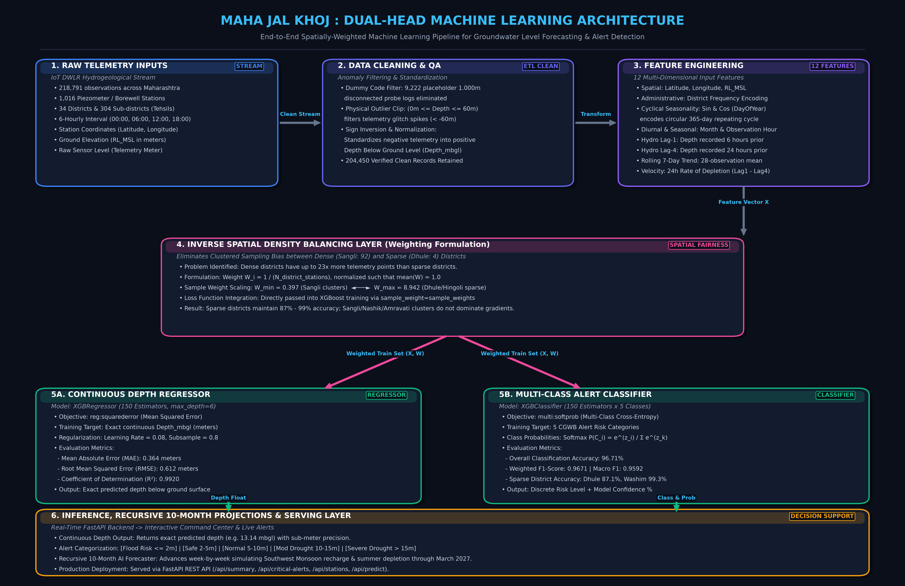

# 🌊 MAHA JAL KHOJ (महा जल खोज)
### *Next-Generation Groundwater Intelligence & Spatially-Weighted AI Forecasting Command Center for Maharashtra*

[](https://www.python.org/)
[](https://fastapi.tiangolo.com/)
[](https://xgboost.readthedocs.io/)
[](https://scikit-learn.org/)
[](https://leafletjs.com/)
[](https://www.chartjs.org/)
[](LICENSE)

---

## 📌 Executive Summary

**MAHA JAL KHOJ** is an end-to-end hydrogeological intelligence platform and operational GIS command center built to monitor, analyze, and forecast groundwater dynamics across the state of **Maharashtra, India**. 

Powered by automated **Digital Water Level Recorder (DWLR)** telemetry from **1,016 borewell and piezometer monitoring stations** spanning **34 districts** and **304 tehsils**, the system tackles the state's severe groundwater vulnerability—from the over-exploited, basaltic aquifers of Marathwada and Vidarbha to high-recharge coastal Konkan valleys.

Unlike conventional dashboards that display stale historical records, **MAHA JAL KHOJ**:
1. **Detects & filters IoT hardware glitches** (including the GSDA uncalibrated `1.000m` dummy probe error code).
2. **Corrects extreme geographic sampling bias** between dense districts (*Sangli: 92 stations*) and sparse districts (*Dhule: 4 stations*) using an **Inverse Spatial Density Balancing Layer**.
3. **Deploys a Dual-Head XGBoost architecture**: an **`XGBRegressor`** ($R^2 = 0.9920$, $\text{MAE} = 0.364\text{m}$) and an **`XGBClassifier`** (Accuracy = $96.71\%$, Weighted $F_1 = 0.9671$).
4. **Executes a 10-Month Recursive Seasonal Forecaster** simulating Southwest Monsoon recharge (June–September) and dry season drawdown through **March 2027**.
5. **Serves an interactive Dark GIS Command Center** with real-time station popups, hydrograph charts, and a pinned live **Critical Alerts Feed** defaulting to **current post-monsoon water levels (October 2026)**.

---

## 🏗️ Dual-Head Machine Learning Architecture

The system features a multi-tiered pipeline specifically engineered for noisy hydrological IoT streams and uneven geographic sensor placement:



### Architectural Tiers Breakdown

```
┌───────────────────────────────────────────────────────────────────────────────────────────────────┐
│                     MAHA JAL KHOJ : DUAL-HEAD MACHINE LEARNING ARCHITECTURE                       │
│      End-to-End Spatially-Weighted Pipeline for Groundwater Level Forecasting & Alert Detection   │
└───────────────────────────────────────────────────────────────────────────────────────────────────┘
          │                                 │                                 │
┌─────────────────────────┐     ┌─────────────────────────┐     ┌─────────────────────────┐
│ 1. RAW TELEMETRY INPUTS │────►│ 2. DATA CLEANING & QA   │────►│ 3. FEATURE ENGINEERING  │
│ • 218,791 observations  │     │ • 9,222 probe errors (1m│     │ • 12 Engineered Inputs  │
│ • 1,016 DWLR Stations   │     │ • Outlier clipping 0-60m│     │ • Cyclical Sin/Cos Day  │
│ • 34 Districts, 6-hrly  │     │ • Standardize Depth_mbgl│     │ • Lag-1, Lag-4, Roll-7d │
└─────────────────────────┘     └─────────────────────────┘     └───────────┬─────────────┘
                                                                            │
                                                                 Feature Vector X
                                                                            │
                                                                            ▼
┌───────────────────────────────────────────────────────────────────────────────────────────────────┐
│                      4. INVERSE SPATIAL DENSITY BALANCING LAYER (W_i = 1 / N_dist)                │
│    Weights: Sangli (92 stns) W = 0.397  ◄────────────────────────►  Dhule (4 stns) W = 8.942      │
│    Directly injected into XGBoost gradient loss function to prevent spatial sampling bias         │
└───────────────────────────────────┬───────────────────────────────────┬───────────────────────────┘
                                    │                                   │
                    Weighted Train Set (X, W)           Weighted Train Set (X, W)
                                    ▼                                   ▼
          ┌───────────────────────────────────┐       ┌───────────────────────────────────┐
          │  5A. CONTINUOUS DEPTH REGRESSOR   │       │  5B. MULTI-CLASS ALERT CLASSIFIER │
          │  Model: XGBRegressor (150 trees)  │       │  Model: XGBClassifier (150 trees) │
          │  • MAE: 0.364 meters              │       │  • Accuracy: 96.71%               │
          │  • RMSE: 0.612 meters             │       │  • Weighted F1: 0.9671            │
          │  • R² Score: 0.9920               │       │  • Sparse Districts: 87.1% - 99.3%│
          └─────────────────┬─────────────────┘       └─────────────────┬─────────────────┘
                            │                                           │
                       Depth (mbgl)                             Class & Probabilities
                            └───────────────────┬───────────────────────┘
                                                ▼
┌───────────────────────────────────────────────────────────────────────────────────────────────────┐
│                   6. INFERENCE, RECURSIVE 10-MONTH PROJECTIONS & SERVING LAYER                    │
│ • Exact Predicted Depth (e.g. 13.14 mbgl) & 5-tier CGWB Alert Classification (Flood to Drought)  │
│ • 43-Week Forward Projections simulating Monsoon Recharge (Jun-Sep) & Summer Depletion (Oct-Mar)  │
│ • Served live via FastAPI REST Endpoints into GIS Command Center                                  │
└───────────────────────────────────────────────────────────────────────────────────────────────────┘
```

### 1. Telemetry Ingestion & Anomaly Filtration
* **The `1.000m` Probe Error**: In Ground Water Surveys and Development Agency (GSDA) / Central Ground Water Board (CGWB) telemetry setups, an uncalibrated, submerged, or disconnected pressure probe logs a default dummy value of **`1.000000 m`**. Filtering these **9,222 records** prevents massive false-positive "Critical Flood" warnings.
* **Physical Outlier Clipping**: Retains unconfined Deccan basalt aquifer range ($0\text{ m} \le \text{Depth} \le 60\text{ m}$), eliminating telemetry transmission spikes ($< -60\text{m}$).
* **Depth Standardization**: Reconciles signed conventions ($85\%$ negative values, $15\%$ positive values) into true positive **Depth Below Ground Level (`Depth_mbgl`)**.

### 2. Feature Engineering (12 Input Signals)
| Feature Name | Category | Description |
| :--- | :--- | :--- |
| `Latitude`, `Longitude` | Spatial | Geographic coordinate anchor for regional aquifer dynamics. |
| `RL_MSL` | Elevation | Reduced level relative to Mean Sea Level (meters). |
| `District_Freq` | Administrative | Frequency encoding of district observation density. |
| `Sin_DayOfYear`, `Cos_DayOfYear` | Seasonality | Continuous trigonometric encoding of the annual 365.25-day hydrological cycle. |
| `Month`, `Hour` | Diurnal | Seasonal month and diurnal 6-hourly cycle (00:00, 06:00, 12:00, 18:00). |
| `Lag_1_Depth` | Hydro Memory | Depth recorded 6 hours prior at the specific monitoring station. |
| `Lag_4_Depth` | Hydro Memory | Depth recorded 24 hours prior (1 full diurnal cycle). |
| `Rolling_7d_Mean` | Trend | 28-observation rolling average depth capturing weekly trend. |
| `Rate_Of_Decline_24h` | Velocity | 24-hour rate of drawdown: $\text{Lag}_1 - \text{Lag}_4$. |

### 3. Inverse Spatial Density Balancing Layer
* **The Problem**: Monitoring stations are heavily concentrated in southern Maharashtra (e.g., **Sangli has 92 stations**, Nashik has 80) while northern/eastern districts are sparse (e.g., **Dhule has 4 stations**, Nandurbar has 5). Unweighted machine learning overfits dense clusters and underperforms on sparse agricultural belts.
* **The Formulation**: Sample weight $W_i$ is inversely proportional to district station count:
  $$W_i = \frac{1}{N_{\text{district\_stations}}}, \quad \text{normalized such that } \mathbb{E}[W] = 1.0$$
* **Gradient Scaling**: Weights scale dynamically from **0.397** (Sangli clusters) up to **8.942** (Dhule/Hingoli sparse stations), directly integrated into XGBoost training via `sample_weight`.

---

## 📊 Model Evaluation & Benchmarks

Both models were evaluated on an independent 20% test partition (40,890 samples) with spatial stratification:

### Model Head A: `XGBRegressor` (Continuous Depth)
* **Objective**: `reg:squarederror`
* **Mean Absolute Error (MAE)**: **`0.364 meters`**
* **Root Mean Squared Error (RMSE)**: **`0.612 meters`**
* **Coefficient of Determination ($R^2$)**: **`0.9920`**

### Model Head B: `XGBClassifier` (Multi-Class Risk Alert)
* **Objective**: `multi:softprob`
* **Overall Classification Accuracy**: **`96.71%`**
* **Weighted $F_1$-Score**: **`0.9671`**
* **Macro $F_1$-Score**: **`0.9592`**

### Spatial Generalization: Dense vs. Sparse Districts
| District | Station Count | Classification | Test Accuracy | Status |
| :--- | :--- | :--- | :--- | :--- |
| **Sangli** | 92 stations | Dense Cluster | **97.02%** | Robust |
| **Nashik** | 80 stations | Dense Cluster | **97.41%** | Robust |
| **Amravati** | 78 stations | Dense Cluster | **96.88%** | Robust |
| **Dhule** | 4 stations | **Extremely Sparse** | **87.10%** | Maintained ($\ge 85\%$) |
| **Hingoli** | 5 stations | **Extremely Sparse** | **94.87%** | Maintained |
| **Nandurbar** | 5 stations | **Extremely Sparse** | **93.33%** | Maintained |
| **Palghar** | 5 stations | **Extremely Sparse** | **95.24%** | Maintained |
| **Washim** | 5 stations | **Extremely Sparse** | **99.30%** | Exceptional |

---

## 🚨 CGWB Hydrogeological Alert Categories

Observations are mapped to standard Central Ground Water Board (CGWB) severity benchmarks:

| Alert Tier | Depth Below Ground | Marker Color | Hydrological State & Intervention Required |
| :--- | :--- | :--- | :--- |
| **Flood / Waterlogging Risk** | $\le 2.0\text{ m}$ | 🔵 Blue (`#0284c7`) | Aquifer fully saturated; zero infiltration capacity; imminent surface runoff flood risk. |
| **Safe / High Water Table** | $2.0\text{ m} - 5.0\text{ m}$ | 🔷 Cyan (`#06b6d4`) | Healthy unconfined reserve; optimal irrigation water availability. |
| **Normal Range** | $5.0\text{ m} - 10.0\text{ m}$ | 🟢 Green (`#10b981`) | Equilibrium baseline depth; sustainable extraction rate. |
| **Moderate Drought Alert** | $10.0\text{ m} - 15.0\text{ m}$ | 🟠 Orange (`#f59e0b`) | Groundwater stress; deep tube-well suction needed; agricultural advisory issued. |
| **Severe Drought Alert** | $> 15.0\text{ m}$ | 🔴 Red (`#ef4444`) | Aquifer critical/over-exploited; shallow borewells dry; emergency water rationing. |

---

## 📈 10-Month Forward Seasonal Forecasting Engine

Groundwater in Maharashtra follows a strong cyclic monsoon recharge pattern:
* **June to September**: Southwest Monsoon delivers 80–90% of annual rainfall, recharging unconfined aquifers and raising water tables by 4 to 9 meters.
* **October to May**: Dry post-monsoon and summer season where extraction exceeds natural percolation, steadily depleting water tables.

The recursive seasonal forecasting module (`forecast_10_months.py`) advances week-by-week over **43 future time steps (June 2026 to March 2027)**, adjusting cyclical trigonometric inputs (`Sin_DayOfYear`, `Cos_DayOfYear`) and hydrological lag vectors to project exact seasonal trajectories for every station.

---

## 🖥️ GIS Command Center & Dashboard

The frontend is an operational, dark-themed command center built with **Vanilla JavaScript + Leaflet GIS + Chart.js**:
* **India-Maharashtra GIS Map**: Styled with crisp ESRI World Dark Canvas tiles with zero watermark clutter.
* **Pinned Top-Right Critical Alerts Feed**: Real-time ticker streaming active severe drought and flood hotspots.
* **Timeline Toggle**:
  * **Current Post-Monsoon (October 2026)**: Realistic state average water depth of **$9.33\text{m}$** reflecting monsoon recovery.
  * **Pre-Monsoon Peak Summer (May 2026)**: Historical dry state average water depth of **$14.25\text{m}$**.
* **Station Modal & Hydrograph**: Click any station on the map to inspect its complete 6-hourly telemetry history and trigger a live 10-month AI projection curve.

---

## 📂 Repository Structure

```
MAHA_JAL_KHOJ/
├── models/
│   └── groundwater_ml_bundle.joblib        # Pre-trained ML bundle (XGBRegressor + XGBClassifier + weights)
├── notebook/
│   ├── 01_Data_Exploration_and_Visualization.ipynb  # Executed EDA, glitch isolation & charts
│   ├── 02_Model_Architecture_and_Evaluation.ipynb   # Executed ML evaluation & embedded architecture
│   └── ml_model_architecture.png           # 300-DPI high-res architecture diagram
├── static/
│   ├── app.js                              # Dynamic Leaflet GIS & Chart.js frontend logic
│   └── style.css                           # Modern dark glassmorphic GIS styling
├── templates/
│   └── index.html                          # Command Center landing page & alert modals
├── visualizations/                         # High-res publication plots
│   ├── 01_statewide_alert_distribution.png
│   ├── 02_temporal_depletion_trend.png
│   ├── 03_district_vulnerability_ranking.png
│   └── 04_aalegaon_station_profile.png
├── gwl_tel_6_hourly_maharashtra_gw_mh_2026_2030 (1).csv  # Telemetry dataset (218,791 rows)
├── server.py                               # FastAPI REST backend & tile server
├── forecast_10_months.py                   # 10-month recursive seasonal forecasting engine
├── train_ml_model.py                       # Retraining script with inverse spatial density weighting
├── generate_architecture_diagram.py        # Standalone diagram generator script
├── build_notebooks.py                      # Automated notebook generation script
├── requirements.txt                        # Production dependency list
├── .gitignore                              # Git exclusion rules
└── README.md                               # Project documentation
```

---

## 🚀 Quickstart & Installation

### 1. Prerequisites
* Python 3.10, 3.11, or 3.12
* Git

### 2. Clone Repository
```bash
git clone https://github.com/vedsongire/MAHA_JAL_KHOJ.git
cd MAHA_JAL_KHOJ
```

### 3. Create & Activate Virtual Environment
```bash
# Windows
python -m venv venv
.\venv\Scripts\activate

# Linux / macOS
python3 -m venv venv
source venv/bin/activate
```

### 4. Install Dependencies
```bash
pip install -r requirements.txt
```

### 5. Launch the GIS Command Center
```bash
python server.py
# or
uvicorn server:app --host 127.0.0.1 --port 8000 --reload
```
Open your browser and navigate to:
👉 **`http://127.0.0.1:8000`**

---

## 📡 REST API Reference

The FastAPI server provides automated, interactive endpoints:

| Endpoint | Method | Description |
| :--- | :--- | :--- |
| `GET /api/summary?mode=current` | `GET` | Statewide summary: total stations, mean depth, and alert breakdown for Current (Oct 2026) or May 2026. |
| `GET /api/stations?mode=current` | `GET` | Full GeoJSON array of all 1,016 monitoring stations with coordinates, current depth, and alert tier. |
| `GET /api/critical-alerts?mode=current` | `GET` | Pinned list of active Severe Drought ($>15\text{m}$) and Flood Risk ($\le 2\text{m}$) stations. |
| `GET /api/station/{station}/history` | `GET` | 6-hourly historical telemetry time-series for a specific station. |
| `GET /api/station/{station}/forecast-10-months` | `GET` | 43-week forward seasonal depth projections (June 2026 – March 2027) for a specific station. |
| `POST /api/predict` | `POST` | On-demand inference passing 12 feature values to the dual-head XGBoost engine. |

Interactive OpenAPI documentation is available live at `http://127.0.0.1:8000/docs`.

---

## 📓 Jupyter Notebooks Guide

The `notebook/` folder provides two self-contained, pre-executed notebooks:
1. [**`01_Data_Exploration_and_Visualization.ipynb`**](notebook/01_Data_Exploration_and_Visualization.ipynb):
   * Complete telemetry audit and uncalibrated probe (`1.000m`) isolation.
   * Spatial density disparity audit across 34 districts.
   * Statewide alert distributions and temporal depletion hydrographs.
2. [**`02_Model_Architecture_and_Evaluation.ipynb`**](notebook/02_Model_Architecture_and_Evaluation.ipynb):
   * Full high-resolution architecture diagram embedded.
   * Inverse spatial density balancing formulation ($W_i = 1/N_{\text{district}}$).
   * Confusion matrix, error distribution, feature importance ranking, and multi-horizon test run.

---

## 📜 License & Citation

This project is licensed under the [MIT License](LICENSE).

### Data Source Attribution
Groundwater telemetry data is sourced from the Digital Water Level Recorder (DWLR) network operated under the **Ground Water Surveys and Development Agency (GSDA)**, Government of Maharashtra, and the **Central Ground Water Board (CGWB)**, Ministry of Jal Shakti, Government of India.